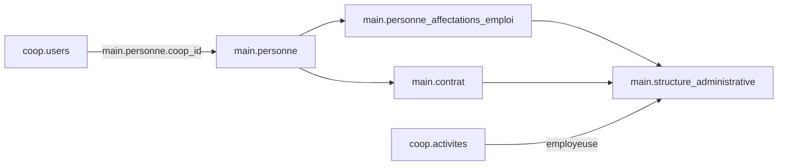

# ADR-002 : Les structures employeuses vivent dans main (Dataspace)

## Auteurs et historique

| Date       | Auteur        | Action                                                                                         |
| ---------- | ------------- | ---------------------------------------------------------------------------------------------- |
| 2026-07-21 | Marc Gavanier | Rédaction initiale : abandonner la table d'employeuses de la coop au profit de celle de `main` |
| 2026-07-23 | Marc Gavanier | Périmètre élargi aux emplois après le cadrage avec l'Entrepôt (#1707)                          |
| 2026-11-17 | Marc Gavanier | Fusion des documents de l'ADR-002 en un seul ADR, aligné sur le code et les abilities          |

## Statut

Accepté

## Contexte

La coop tenait sa propre table de structures employeuses et sa propre table d'emplois, qui reliait
chaque utilisateur à ses employeuses avec des dates de début et de fin. Le Dataspace tient de son
côté, dans le schéma `main`, la référence partagée entre les produits de l'inclusion numérique :
`main.structure_administrative` pour les structures, `main.personne` pour les personnes,
`main.personne_affectations_emploi` pour leurs rattachements et `main.contrat` pour les contrats
du dispositif conseiller numérique.

Les deux côtés décrivaient les mêmes entités. Une synchronisation recopiait les employeuses de la
coop vers `main`, et l'Entrepôt réimportait les utilisateurs de la coop pour en déduire les
affectations. Cette duplication avait un coût permanent :

- **dérive** : des employeuses arrivaient côté coop sans ligne correspondante dans `main`, de
  l'ordre d'une tous les deux jours ;
- **doublons** et appariements approximatifs pour raccrocher les données de la coop aux autres
  produits ;
- **synchronisation** à maintenir des deux côtés, dont l'Entrepôt dépendait pour tenir ses
  affectations à jour.

La base de la coop vit dans le schéma `coop` de la même base que `main` : lire et écrire `main`
depuis la coop est une requête dans la même base, pas un appel distant. C'est ce qui rend la
décision possible.

## Décision

La coop ne fait plus autorité sur les structures employeuses ni sur les emplois. Elle lit le schéma
`main` du Dataspace, et n'y écrit que ce que l'inscription d'un utilisateur exige.

### Principe : le Dataspace fait autorité sur `main`, la coop s'y conforme

Le Dataspace fait autorité sur le schéma `main`. La coop en est cliente et s'y conforme. Les
évolutions de `main` se décident et s'appliquent du côté du Dataspace : quand la coop a besoin
d'une évolution, elle la demande à l'équipe Dataspace. La coop ne modifie jamais `main` pour ses
propres besoins techniques. Le Dataspace reste libre de référencer la coop ou d'en tenir compte
s'il le souhaite : c'est son choix, pas une obligation.

### 1. La coop lit les employeuses, et n'en crée qu'à l'inscription

`main.structure_administrative` est la seule table des structures employeuses. La coop la lit
partout où elle affiche, filtre ou compte une employeuse. Elle n'y crée une ligne que lorsqu'un
utilisateur, à l'inscription, se rattache à une structure que `main` ne connaît pas encore.

La table d'employeuses de la coop, la synchronisation vers `main` et la dérive qu'elle laissait
passer disparaissent ensemble.

### 2. Le périmètre couvre aussi les emplois

Retirer les employeuses sans retirer les emplois aurait gardé, côté coop, une table qui pointe vers
`main` tout en restant la vérité sur les rattachements. Le rattachement d'un utilisateur à son
employeuse vit donc dans `main.personne_affectations_emploi`, avec la source `coop` que le Dataspace
a choisi de porter pour ce que la coop déclare. La table d'emplois de la coop disparaît.

### 3. Le lien passe par `main.personne.coop_id`

Les utilisateurs de la coop ne migrent pas vers `main`. Un utilisateur est relié à sa personne par
la colonne `main.personne.coop_id`, que le Dataspace a choisi de porter et que l'Entrepôt
renseignait déjà. La coop
traverse ce lien pour aller de l'utilisateur à ses affectations, puis à ses employeuses.

### 4. La personne est trouvée ou créée à l'inscription, avec l'email comme pivot

Quand un utilisateur se rattache à une employeuse, la coop cherche sa personne dans `main`, toutes
sources confondues, par son email. Si elle existe déjà, venue d'un autre flux comme le dispositif
conseiller numérique, la coop y pose son `coop_id`. Sinon, elle la crée. La personne, la structure
et l'affectation s'écrivent dans la même transaction : un utilisateur n'est jamais rattaché à moitié.

### 5. L'employeuse courante vient de `est_active`, les dates de `main.contrat`

L'employeuse courante d'un utilisateur est celle de son affectation active. Les dates d'emploi
viennent de `main.contrat` quand il en existe un ; sans contrat couvrant une date, l'employeuse
courante fait foi.

Les dates d'emploi que tenait la coop sont abandonnées. La perte est mesurée : seuls les
utilisateurs ayant eu plusieurs employeuses dans le temps sans contrat pour les départager, environ
2 % des utilisateurs, perdent l'employeuse exacte d'une date passée. Les dates de la coop étaient
d'ailleurs surtout des artefacts d'inscription, posées au jour où l'utilisateur remplissait le
formulaire plutôt qu'au début réel de son emploi.

Le rattachement déclaré par la coop affirme l'employeur courant : rattacher un utilisateur à une
nouvelle employeuse clôt sa précédente affectation de source `coop`, et seulement celle-là.

### 6. Le dispositif fait autorité sur le déclaratif

Quand un utilisateur porte à la fois une affectation déclarée par la coop et une affectation du
dispositif conseiller numérique, c'est celle du dispositif qui désigne l'employeuse. Les
affectations des autres sources appartiennent à l'Entrepôt : la coop ne les modifie pas. Le détail
de la priorité et de la clôture vit dans les abilities de la feature employeuse.

### 7. Cible : une clé étrangère des activités vers `main`, en `RESTRICT`

Une activité garde l'employeuse de son médiateur au moment de l'intervention. La cible est une
vraie clé étrangère de `coop.activites` vers `main.structure_administrative` :

- en `ON DELETE RESTRICT`, pour qu'une suppression physique d'employeuse côté Entrepôt soit
  bloquée par nos lignes au lieu de les débrancher sans bruit ;
- sur une colonne `NOT NULL`, puisque toute activité a une employeuse ;
- sous le nom canonique de la colonne, sans suffixe de transition.

C'est aussi ce qu'attend la fusion d'employeuses de l'Entrepôt, qui repointe les références vers
la structure conservée avant de supprimer l'autre : `RESTRICT` garantit qu'aucune référence n'a été
oubliée.

Cette contrainte est posée uniquement côté coop, sans aucune modification de `main`. Elle a
pourtant un coût pour le Dataspace :

- le rôle de la coop doit avoir le droit de référencer `main.structure_administrative`, droit que
  le Dataspace accorde ;
- un `TRUNCATE` ou un `DROP` de la table sans cascade est refusé tant que la clé existe ;
- en `RESTRICT`, la suppression d'une employeuse encore référencée par une activité est bloquée.

Ce coût est assumé. Le Dataspace garde la décision sur ses propres choix, et une suppression bloquée
par cette contrainte protège les données de la coop contre une perte silencieuse.

État actuel : la clé étrangère existe mais reste en `SET NULL`, sur une colonne nullable portant
encore son nom de transition. Cible à atteindre, ticket à ouvrir. Le passage à `NOT NULL` et le
renommage se font en deux temps : d'abord le code adapté, sans migration destructive, puis, une
fois ce code en production, la migration seule. Le code encore en service n'est ainsi jamais cassé
par une migration appliquée avant son remplacement.

### 8. Cible : la coop ne modifie jamais le schéma `main`

Le Dataspace fait autorité sur le schéma `main` : son équipe en décide les évolutions et les
applique avec Flyway, y compris celles que la coop lui demande. La coop le considère comme existant
une fois appliqué de leur côté, et ne le modifie jamais pour ses propres besoins techniques : aucune
migration de la coop ne crée, n'altère ni ne supprime d'objet de `main`. Seules sont admises les
clés étrangères de tables de la coop vers `main`, et l'écriture de données.

La cible rend cette interdiction structurelle : une migration de la coop qui toucherait la
structure de `main` ne doit pas pouvoir exister. Trois verrous la portent :

1. **Droits de base** : le rôle qui applique les migrations de la coop n'a aucun droit de
   modification de structure sur `main`. Il y a la lecture, l'écriture de données et le droit de
   référencer, rien d'autre.
2. **Configuration Prisma** : les objets de `main` sont déclarés externes. Prisma les décrit pour
   les lire, les écrire et les joindre, mais ne génère aucune commande de structure pour eux.
3. **Contrôle automatique en CI** des fichiers de migration : il refuse toute commande de création,
   de modification ou de suppression visant `main`, hors clés étrangères de la coop vers `main`.

En CI et en local, la structure de `main` vient d'un instantané de celle du Dataspace, et non des
modèles Prisma de la coop. Les migrations existantes qui touchent `main` sont historiques : elles
ne sont pas réécrites.

Décrire des tables qu'on ne possède pas expose à une évolution du Dataspace qui casserait la coop
sans prévenir. Une garde anti-dérive compare le schéma `main` réel à un instantané de référence
versionné et échoue s'il a divergé. Elle doit couvrir toutes les tables de `main` que la coop
décrit.

Un second client Prisma subsiste pour la lecture des lieux. Il ne sert qu'à lire et n'est jamais
passé aux migrations : il ne peut émettre aucune commande de structure. Il est conservé tant que
l'exclusion de `main` des migrations de la coop n'est pas en place, et sa suppression est
conditionnée à elle.

État actuel : aucun des trois verrous n'est en place. Les tables de `main` décrites par la coop ne
sont pas déclarées externes, et sur une base vide (CI, environnements de preview, base locale) ce
sont les migrations de la coop qui créent la structure de `main` ; les plus récentes ne le font
que si elle est absente. La garde anti-dérive ne couvre que trois tables (structures, adresses,
lieux), tourne à la demande en local et jamais en CI, faute d'identifiant de la base de
production. Cible à atteindre, ticket à ouvrir.

### 9. Les référents sont lus dans `main`, le complément d'adresse est abandonné

Le référent d'une employeuse, affiché dans la fiche d'administration et dans le réseau du médiateur,
est lu dans `main.structure_administrative.contact`, que renseignent les producteurs du Dataspace.
La coop le lit sans jamais y écrire : cette colonne a une sémantique qui ne lui appartient pas.
Le complément d'adresse, absent de `main`, est abandonné.

### 10. La fusion d'employeuses appartient à l'Entrepôt

La coop ne fusionne plus d'employeuses. Les doublons de `main.structure_administrative` se règlent
côté Entrepôt, qui en est le propriétaire.

### 11. Les lieux sont hors périmètre

Les lieux d'activité restent tenus par la coop, et `main` les reçoit comme consommateur. Cette
décision ne porte que sur les employeuses et les emplois. Le seul point de rencontre est
l'inscription, où un médiateur peut déclarer son employeuse comme lieu d'activité : la coop
matérialise alors un lieu à partir de l'employeuse, sans garder de lien entre les deux.

### 12. La qualité des SIRET d'employeurs appartient à l'Entrepôt

La coop consulte les SIRET des employeuses sans les corriger. Leur normalisation, leur
dédoublonnage et leur vérification relèvent de l'Entrepôt. L'outillage de qualité des SIRET de la
coop ne porte plus que sur les lieux.

## Alternatives écartées

### Ne basculer que la structure administrative

C'était le premier périmètre : remplacer la table d'employeuses de la coop par
`main.structure_administrative`, en gardant la table d'emplois. Elle aurait gardé côté coop la
vérité sur les rattachements, donc une synchronisation vers les affectations de `main`, et une table
appelée à disparaître dont il aurait fallu repointer toutes les lectures pour rien.

### Migrer les utilisateurs de la coop vers `main.personne`

Faire de `main.personne` la table des utilisateurs aurait touché l'authentification, les sessions
et l'essentiel des écrans. Relier l'utilisateur à sa personne par `coop_id` donne le même accès aux
affectations sans déplacer les comptes.

### Étendre les affectations avec des dates

Ajouter un début et une fin à `main.personne_affectations_emploi` aurait gardé l'historique complet,
au prix d'un changement de schéma côté Entrepôt pour des dates qui, côté coop, étaient surtout des
artefacts d'inscription.

### Écrire dans `main.contrat`

`main.contrat` porte les contrats du dispositif conseiller numérique. Y écrire les emplois déclarés
par la coop aurait détourné sa sémantique, et exigé de reconstituer des contrats pour les quelque
53 % d'affectations de source `coop` qui n'en ont pas, à partir de dates peu fiables.

### Consommer la table d'association entre lieux et employeuses

L'Entrepôt avait matérialisé une table d'association entre `main.lieu_inclusion` et
`main.structure_administrative`. La consommer aurait ajouté un couplage au schéma de l'Entrepôt
sur un sujet, les lieux, que cette décision laisse hors périmètre. La coop ne s'en sert pas.

### Une clé étrangère en `SET NULL`

C'est la valeur que Prisma génère par défaut pour une relation nullable. Une suppression physique
d'employeuse côté Entrepôt viderait alors en silence l'employeuse de nos activités, au lieu d'être
bloquée, et contredirait la fusion de l'Entrepôt qui repointe avant de supprimer.

### Un contrôle par job, sans contrainte

Une colonne entière non contrainte, vérifiée par un job périodique, aurait évité de coupler nos
tables au schéma de l'Entrepôt. Elle laisse passer les références cassées jusqu'au prochain
passage du job, quand une contrainte les refuse au moment de l'écriture.

## Conséquences

**Positives**

- Une seule source pour les structures employeuses et les rattachements, partagée avec les autres
  produits de l'inclusion numérique.
- Plus de synchronisation des employeuses ni des emplois, et plus de dérive par construction.
- L'inscription écrit directement dans `main`, dans une seule transaction.

**Négatives ou à surveiller**

- **Pertes assumées** : les dates d'emploi tenues par la coop, la piste d'audit de la table
  d'emplois (qui a créé, modifié, supprimé) et le complément d'adresse des employeuses.
- **Couplage** au schéma de `main`, géré par l'Entrepôt avec Flyway : une évolution de leur côté
  peut casser notre client. La garde anti-dérive le détecte, elle ne l'empêche pas : la coop s'y
  conforme, ou demande à l'équipe Dataspace l'évolution dont elle a besoin.
- **Coût de la clé étrangère pour le Dataspace** : le rôle de la coop doit pouvoir référencer
  `main.structure_administrative`, un `TRUNCATE` ou un `DROP` sans cascade est refusé, et une fois
  en `RESTRICT` nos lignes bloquent la suppression d'une employeuse encore référencée : il faut
  repointer avant de supprimer. Coût assumé, parce qu'il protège les données de la coop. La
  contrainte est posée uniquement côté coop et ne demande aucune modification de `main`.
- **Plusieurs agrégats de contexte à garder** : une même personne peut avoir plusieurs employeuses,
  environ 4 % des utilisateurs, et environ 53 % des affectations de source `coop` n'ont pas de
  contrat. Les lectures distinguent donc l'employeuse courante, l'employeuse à une date et
  l'historique, au lieu d'une seule employeuse par utilisateur.

**Dépendances côté Entrepôt**

La décision se tient à deux : plusieurs points relèvent de l'Entrepôt.

- **Droits** : le Dataspace accorde à la coop les droits nécessaires sur les tables de `main`
  qu'elle lit et écrit (lecture, écriture de données et référence), la coop ne détenant aucun droit
  de modification de structure sur `main`. Ces droits doivent être posés par Flyway, pour exister
  dans une base fraîche et pas seulement en production.
- **Sens de `est_active` pour la source `coop`** : la coop le maintient désormais elle-même, à la
  place du cycle de réactivation que tenait l'import de l'Entrepôt ; la sémantique est à poser avec
  lui (#1729).
- **Clé étrangère de `main.personne.coop_id` vers `coop.users`** : le Dataspace a choisi de la
  porter ; elle vit sur une table de `main`, donc dans Flyway. Elle suppose une personne au plus
  par utilisateur.
- **Réconciliation inachevée** : des comptes en conflit, où deux utilisateurs actifs prétendent à la
  même personne, restent à trancher à la main, et des conseillers numériques absents de `main`,
  faute d'email concordant, restent à rapprocher.

## Où trouver le détail

Les abilities décrivent chaque comportement ; ce sont des specs exécutables, jouées par les tests
Cucumber de chaque feature, et elles font foi.

- Feature employeuse : [consulter l'employeuse courante](../../src/features/employeuse/abilities/consulter-employeuse-actuelle/consulter-employeuse-actuelle.ability.md),
  [consulter l'employeuse à une date](../../src/features/employeuse/abilities/consulter-employeuse-a-une-date/consulter-employeuse-a-une-date.ability.md),
  [consulter l'historique des employeuses](../../src/features/employeuse/abilities/consulter-historique-employeuses/consulter-historique-employeuses.ability.md),
  [rattacher à une employeuse](../../src/features/employeuse/abilities/rattacher-a-une-employeuse/rattacher-a-une-employeuse.ability.md),
  [consulter une employeuse](../../src/features/employeuse/abilities/consulter-employeuse/consulter-employeuse.ability.md),
  [lister les employeuses](../../src/features/employeuse/abilities/lister-employeuses/lister-employeuses.ability.md)
  et [rechercher une employeuse](../../src/features/employeuse/abilities/rechercher-employeuse/rechercher-employeuse.ability.md).
- Feature inscription : [initialiser l'inscription](../../src/features/inscription/abilities/initialiser-inscription/initialiser-inscription.ability.md),
  [renseigner sa structure employeuse](../../src/features/inscription/abilities/renseigner-structure-employeuse/renseigner-structure-employeuse.ability.md)
  et [la structure employeuse comme lieu d'activité](../../src/features/inscription/abilities/ajouter-structure-employeuse-en-lieu/ajouter-structure-employeuse-en-lieu.ability.md).
- Les [migrations](../../prisma/migrations/) retracent le passage du schéma, jusqu'au
  retrait des tables d'employeuses et d'emplois de la coop.
- Le code de la [feature employeuse](../../src/features/employeuse/) et de la
  [feature inscription](../../src/features/inscription/) en est l'implémentation ; le
  [schéma Prisma](../../prisma/schema.prisma) décrit les tables de `main` que la coop
  utilise.

## Références

- [anct-cnum/suite-gestionnaire-numerique#1705](https://github.com/anct-cnum/suite-gestionnaire-numerique/issues/1705) : synchroniser les structures et les lieux de `main` avec la coop
- [anct-cnum/suite-gestionnaire-numerique#1707](https://github.com/anct-cnum/suite-gestionnaire-numerique/issues/1707) : rendre caduque la table d'employeuses de la coop
- [anct-cnum/suite-gestionnaire-numerique#1729](https://github.com/anct-cnum/suite-gestionnaire-numerique/issues/1729) : sens de `est_active` sous écriture directe de la coop
- [inclusion-numerique/coop-mediation-numerique#575](https://github.com/inclusion-numerique/coop-mediation-numerique/pull/575) : relecture de la bascule par l'Entrepôt
