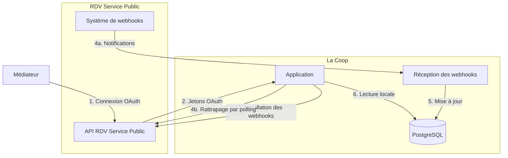

# Intégration avec RDV Service Public

## Context and Problem Statement

La Coop de la médiation numérique permet aux médiateurs de suivre leurs
activités et leurs bénéficiaires. Parallèlement,
[RDV Service Public](https://www.rdv-service-public.fr/) est une plateforme
dédiée à la prise de rendez-vous pour les services publics, utilisée
notamment par les médiateurs numériques pour gérer leurs rendez-vous avec les
usagers.

Il existe un besoin fort d'intégrer ces deux systèmes afin de :

1. **Éviter la double saisie** : Les médiateurs doivent actuellement saisir
   leurs activités dans La coop et gérer leurs rendez-vous dans RDV Service
   Public séparément
2. **Synchroniser les bénéficiaires** : Un usager créé dans RDV Service
   Public devrait pouvoir être automatiquement accessible dans La coop
3. **Créer des CRAs depuis des RDVs** : Permettre la création d'activités
   (Comptes-Rendus d'Accompagnement) dans La coop à partir de rendez-vous
   honorés dans RDV Service Public
4. **Afficher une vue unifiée** : Présenter aux médiateurs une vue
   consolidée de leurs activités et rendez-vous

L'API de RDV Service Public fournit :

- Un système d'authentification OAuth 2.0
- Des endpoints REST pour accéder aux données (RDVs, usagers, organisations,
  etc.)
- Un système de webhooks pour notifier des changements de données
- **Mais ne fournit pas** de mécanismes de filtrage avancés, de comptage
  optimisé, ni de pagination unifiée avec nos activités

## Considered Options

- Intégration avec RDV Service Public (option retenue)
- Appels API directs sans synchronisation
- Cache en mémoire (Redis) temporaire
- Synchronisation locale en lecture seule (sans webhooks)
- Synchronisation bidirectionnelle complète

## Decision Outcome

Option retenue : « Intégration avec RDV Service Public ».

La Coop copie localement, dans sa base PostgreSQL, les données de RDV Service
Public dont elle a besoin, plutôt que d'interroger l'API distante à chaque
affichage.

Les données circulent de RDV Service Public vers La Coop. Les écritures en
retour sont rares et ciblées : la demande de rendez-vous pour un
bénéficiaire, le statut de présence d'un rendez-vous, et l'installation des
webhooks.

Le détail de chaque comportement vit dans les abilities, specs exécutables qui
font foi. Cet ADR n'en garde que le principe.

### Architecture globale

### Composants de l'intégration

#### 1. Authentification OAuth 2.0

Le médiateur relie son compte La Coop à son compte d'agent RDV Service Public
par le flux standard OAuth 2.0 (code d'autorisation). Les jetons sont conservés
sur le compte et renouvelés automatiquement avant leur expiration.

Voir
[connecter un compte](../../src/features/rdvsp/abilities/connecter-compte-rdv/connecter-compte-rdv.ability.md)
et
[déconnecter un compte](../../src/features/rdvsp/abilities/deconnecter-compte-rdv/deconnecter-compte-rdv.ability.md).

#### 2. Webhooks (stratégie principale)

La Coop installe un webhook sur chaque organisation de l'agent et reçoit les
créations, modifications et suppressions de rendez-vous et d'usagers presque en
temps réel.

Voir
[recevoir une notification de rendez-vous](../../src/features/rdvsp/abilities/recevoir-webhook-rdv/recevoir-webhook-rdv.ability.md)
et
[recevoir une notification d'usager](../../src/features/rdvsp/abilities/recevoir-webhook-usager/recevoir-webhook-usager.ability.md).

#### 3. Polling de rattrapage (stratégie de repli)

Quand un webhook manque ou échoue, La Coop interroge l'API pour rattraper
l'écart : à la première connexion, à la demande du médiateur, au chargement
des écrans qui affichent des rendez-vous, et chaque nuit. Le rattrapage ne
parcourt que ce que les webhooks n'ont pas rapporté.

Voir
[synchroniser un compte](../../src/features/rdvsp/abilities/synchroniser-compte-rdv/synchroniser-compte-rdv.ability.md),
[déclencher une synchronisation](../../src/features/rdvsp/abilities/declencher-synchronisation/declencher-synchronisation.ability.md),
[synchroniser les organisations](../../src/features/rdvsp/abilities/synchroniser-organisations/synchroniser-organisations.ability.md)
et
[synchroniser les rendez-vous](../../src/features/rdvsp/abilities/synchroniser-rdvs/synchroniser-rdvs.ability.md).

### Modèle de données synchronisées

La Coop garde localement les organisations, rendez-vous, participations,
usagers, motifs et lieux de l'agent, ainsi que les webhooks installés et
l'historique des synchronisations. Le schéma Prisma en est la référence ; les
règles de réconciliation sont décrites par les abilities de synchronisation
ci-dessus, et le suivi des comptes par
[administrer les comptes RDV](../../src/features/rdvsp/abilities/administrer-comptes-rdv/administrer-comptes-rdv.ability.md).

#### Liaison avec nos modèles métier

**Bénéficiaires** : un usager RDV Service Public devient un bénéficiaire de
La Coop, créé ou fusionné avec un bénéficiaire existant. Voir
[créer ou fusionner depuis un usager externe](../../src/features/beneficiaire/abilities/creer-ou-fusionner-depuis-usager-externe/creer-ou-fusionner-depuis-usager-externe.ability.md)
et
[prendre un rendez-vous](../../src/features/rdvsp/abilities/prendre-rendez-vous/prendre-rendez-vous.ability.md).

**Activités** : un rendez-vous honoré peut devenir une activité (CRA), et les
rendez-vous se mêlent aux activités dans la liste du médiateur. Voir
[créer une activité depuis un rendez-vous](../../src/features/rdvsp/abilities/creer-activite-depuis-rdv/creer-activite-depuis-rdv.ability.md),
[mettre à jour le statut d'un rendez-vous](../../src/features/rdvsp/abilities/mettre-a-jour-statut-rdv/mettre-a-jour-statut-rdv.ability.md),
[lister les rendez-vous des activités](../../src/features/rdvsp/abilities/lister-les-rdvs-des-activites/lister-les-rdvs-des-activites.ability.md)
et
[lister mes activités](../../src/features/activites/abilities/lister-mes-activites/lister-mes-activites.ability.md).

### Pourquoi une synchronisation locale ?

#### Intégrité référentielle et clés étrangères

En synchronisant les données localement, nous pouvons établir des relations
fortes via des clés étrangères entre :

- Les RDVs et nos activités
- Les usagers RDV et nos bénéficiaires
- Les RDVs et leurs participations, lieux, motifs

Cela garantit :

- L'intégrité des données (cascade de suppression, contraintes)
- Des requêtes SQL performantes avec jointures
- Une cohérence transactionnelle

**Sans synchronisation locale**, nous devrions :

- Faire plusieurs appels API séquentiels pour reconstituer les relations
- Gérer manuellement la cohérence (que faire si un RDV référence un usager
  supprimé ?)
- Risquer des incohérences en cas d'erreur réseau partielle

#### Performance des requêtes : comptages et agrégations

L'API RDV Service Public ne fournit pas d'endpoints optimisés pour :

- Compter le nombre de RDVs avec des filtres complexes
- Agréger des données (nombre de RDVs par statut, par mois, etc.)

Nos interfaces nécessitent ces comptages : l'accueil du médiateur (rendez-vous
à venir, rendez-vous passés, CRA à rédiger) et les statistiques (nombre
total d'activités incluant les RDVs convertis, ventilations, comptages avec
filtres multiples).

**Sans synchronisation locale**, chaque comptage nécessiterait :

1. Un appel API pour récupérer TOUS les RDVs (pas d'endpoint de comptage)
2. Un filtrage côté application
3. Un comptage en mémoire

Pour un médiateur avec 200 RDVs, cela représenterait plusieurs secondes de
traitement et une surcharge réseau significative.

#### Filtrage avancé et recherche

La liste des activités filtre simultanément les activités La coop et les RDVs
RDV Service Public, par plage de dates, bénéficiaire, lieu, type d'activité,
thématique ou statut du RDV. Ces filtres s'appliquent en une seule requête SQL
sur les deux sources réunies.

**Sans synchronisation locale**, nous devrions :

1. Récupérer toutes les activités via SQL
2. Récupérer tous les RDVs via l'API (potentiellement plusieurs appels
   paginés)
3. Fusionner et trier en mémoire
4. Paginer en mémoire

Cette approche serait :

- Très lente (plusieurs secondes)
- Impossible à paginer côté serveur
- Consommatrice en mémoire
- Source d'incohérences (données API pouvant changer entre les appels)

#### Pagination unifiée

L'API RDV Service Public a sa propre pagination. Fusionner une liste paginée
d'activités La coop avec une liste paginée de RDVs distants est
mathématiquement complexe :

**Problème :**

- Page 1 d'activités : 25 éléments du 1er janvier au 15 janvier
- Page 1 de RDVs : 20 éléments du 5 janvier au 20 janvier
- Comment afficher une « page 1 » unifiée triée par date ?

Il faudrait :

1. Charger toutes les pages des deux sources jusqu'à obtenir assez d'éléments
   pour la page demandée
2. Trier l'ensemble
3. Découper en pages

Cela rend la pagination quasi impossible en pratique sans synchronisation
locale.

#### Disponibilité et résilience

Avec une synchronisation locale :

- Les données RDV restent accessibles même si l'API RDV Service Public est
  indisponible
- Les requêtes de consultation sont instantanées (lecture en base locale)
- Les erreurs réseau n'impactent que la synchronisation, pas la consultation

**En mode API direct** :

- Chaque page chargée dépend de la disponibilité de l'API RDV
- Une lenteur de l'API RDV ralentit toute notre application
- Un dépassement de délai de l'API donne une page blanche à l'utilisateur

#### Coût et latence réseau

Chaque appel à l'API RDV Service Public :

- Ajoute une latence réseau (50 à 200 ms selon la charge)
- Consomme d'éventuels quotas d'API
- Peut nécessiter le renouvellement du jeton OAuth

**Exemple concret** : afficher la liste de 50 activités et RDVs avec filtres

| Approche               | Appels API                      | Durée             |
| ---------------------- | ------------------------------- | ----------------- |
| Synchronisation locale | 0 (données déjà en local)       | 50 à 100 ms (SQL) |
| API directe            | 2 à 5 (pagination, dépendances) | 500 à 1000 ms     |

Sur un tableau de bord affichant plusieurs blocs (prochains RDVs, compteurs,
etc.), l'approche locale est **10 à 20 fois plus rapide**.

### Pourquoi webhooks et polling en repli ?

Les webhooks sont la voie principale : ils tiennent la copie locale à jour
presque en temps réel, sans appel inutile ni action du médiateur. Mais un
webhook peut ne pas s'installer sur une organisation, ou échouer sans bruit. Le
polling de rattrapage couvre ces trous, en ne visant que ce que les webhooks
n'ont pas rapporté.

Les déclencheurs du rattrapage, le traitement des erreurs (jetons,
synchronisation, webhooks) et le journal de chaque synchronisation sont décrits
par les abilities
[synchroniser un compte](../../src/features/rdvsp/abilities/synchroniser-compte-rdv/synchroniser-compte-rdv.ability.md),
[déclencher une synchronisation](../../src/features/rdvsp/abilities/declencher-synchronisation/declencher-synchronisation.ability.md)
et
[administrer les comptes RDV](../../src/features/rdvsp/abilities/administrer-comptes-rdv/administrer-comptes-rdv.ability.md).

### Consequences

- Good, because **performance** : les requêtes de lecture sont instantanées
  sur la base locale, les comptages et les agrégations sont optimisés, et la
  pagination est efficace.
- Good, because **fonctionnalités avancées** : filtrage multicritère,
  recherche unifiée des activités et des RDV, statistiques complexes.
- Good, because **expérience utilisateur** : l'interface est réactive, sans
  latence réseau lors de la navigation, et reste disponible même si l'API RDV
  est indisponible.
- Good, because **intégrité des données** : relations fortes (clés
  étrangères) entre entités, cohérence transactionnelle, cascade de
  suppression.
- Good, because **résilience** : les webhooks donnent un quasi temps réel
  quand c'est possible, le polling prend le relais s'ils échouent, et les
  données restent accessibles même en cas d'indisponibilité de l'API.
- Bad, because **complexité** : du code de synchronisation à maintenir, la
  gestion des webhooks et du repli, la détection et la résolution des conflits
  potentiels.
- Bad, because **stockage** : les données de RDV Service Public sont
  dupliquées, la base grossit et ses index demandent de la maintenance.
- Bad, because **latence de synchronisation** : les données ne sont pas
  exactement en temps réel (webhook : de l'ordre de la seconde ; polling :
  plusieurs minutes), et une désynchronisation temporaire est possible si les
  webhooks sont défaillants.
- Bad, because **migration et évolution** : si l'API RDV change, notre
  synchronisation doit suivre, et un webhook mal configuré peut faire dériver
  les données sans être détecté.
- Bad, because **coût de développement initial** : plus complexe qu'un simple
  appel API, la synchronisation demande des tests robustes.
- Neutral, because la dérive entre la copie locale et l'API est calculée à
  chaque synchronisation et affichée dans l'administration.
- Neutral, because les écrans qui affichent des rendez-vous les rattrapent à
  leur chargement.
- Neutral, because un polling nocturne parcourt tous les comptes.
- Neutral, because les réponses de l'API RDV Service Public sont validées à
  l'exécution.
- Neutral, because un test de contrat porte sur des payloads réels capturés de
  l'API.

## Pros and Cons of the Options

### Alternative 1 : Appels API directs sans synchronisation

**Principe** : Interroger l'API RDV Service Public à chaque affichage

**Avantages** :

- Simplicité de développement
- Pas de désynchronisation possible
- Pas de stockage dupliqué

**Inconvénients** :

- Latence réseau à chaque consultation
- Impossible à filtrer, paginer et compter efficacement
- Pas de vue unifiée activités et RDVs
- Dépendance totale à la disponibilité de l'API

**Raison du rejet** : Incompatible avec nos besoins de performance et de
fonctionnalité (pagination unifiée, filtres, statistiques).

### Alternative 2 : Cache en mémoire (Redis) temporaire

**Principe** : Utiliser Redis pour mettre en cache les données RDV pendant
quelques minutes

**Avantages** :

- Plus rapide que les appels API directs
- Pas de stockage permanent

**Inconvénients** :

- Pas de relations SQL (pas de jointures)
- Difficile de gérer les filtres complexes
- Invalidation du cache complexe
- Pas de persistance (perte du cache au redémarrage)
- Ne résout pas le problème de pagination unifiée
- Infrastructure supplémentaire à mettre en place et à maintenir

**Raison du rejet** : Ne répond pas aux besoins d'intégrité référentielle
et de requêtage avancé.

### Alternative 3 : Synchronisation locale en lecture seule (sans webhooks)

**Principe** : Synchronisation uniquement via polling périodique (par exemple
toutes les 10 minutes)

**Avantages** :

- Plus simple que webhooks et polling
- Mêmes avantages de performance que l'approche retenue

**Inconvénients** :

- Latence de synchronisation élevée (jusqu'à 10 minutes)
- Surcharge de l'API (polling constant même sans changement)
- Expérience utilisateur dégradée (données pas à jour)

**Raison du rejet** : Latence inacceptable pour un outil de gestion quotidien.
Les médiateurs créent des RDVs et veulent les voir immédiatement.

### Alternative 4 : Synchronisation bidirectionnelle complète

**Principe** : Permettre la création et la modification de RDVs depuis La coop,
synchronisées vers RDV Service Public

**Avantages** :

- La Coop devient source de vérité
- Les médiateurs n'ont plus besoin d'aller sur RDV Service Public

**Inconvénients** :

- Complexité très élevée (gestion des conflits)
- Risque de désynchronisation
- RDV Service Public a des règles métier complexes (disponibilités,
  contraintes horaires)
- Hors périmètre du besoin initial

**Raison du rejet** : Trop complexe pour les bénéfices. RDV Service Public
reste la source de vérité pour les RDVs ; La coop les consomme en lecture et
les convertit en activités.

**Note** : La Coop permet tout de même de demander un rendez-vous pour un
bénéficiaire via l'API RDV, sans gérer le cycle de vie complet du
rendez-vous.

## More Information

### Où trouver le détail

Les abilities des features [rdvsp](../../src/features/rdvsp/abilities/),
[beneficiaire](../../src/features/beneficiaire/abilities/) et
[activites](../../src/features/activites/abilities/) décrivent chaque
comportement de l'intégration. Ce sont des specs exécutables : les tests
Cucumber de chaque feature les jouent, et elles font foi. Le code de la
[feature rdvsp](../../src/features/rdvsp/) en est l'implémentation.

### Références

- [RDV Service Public - Documentation API](https://www.rdv-service-public.fr/api-docs/index.html)
- [OAuth 2.0 RFC](https://datatracker.ietf.org/doc/html/rfc6749)
- [schema.prisma](../../prisma/schema.prisma) : schéma de données complet
- [Abilities RDV Service Public](../../src/features/rdvsp/abilities/) : specs
  exécutables de l'intégration

### Pistes envisagées, non réalisées, à reconsidérer plus tard

- Tests d'intégration contre l'API RDV Service Public
- Barre de progression pendant une synchronisation longue
- Gestion des conflits d'écriture par horodatage
- Alerte quand la dérive dépasse un seuil
- Politique de rétention des journaux de synchronisation et des anciens
  rendez-vous

### Historique

- 2025-11-25, Hugues Maignol : rédaction initiale de l'ADR.
- 2026-11-17, Marc Gavanier : alignement sur les abilities ; le détail renvoie
  aux specs exécutables, pas au code.
